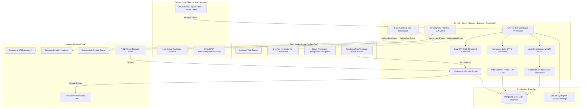

# CivicPulse — AI-Powered Civic Issue Reporting & Resolution Platform

CivicPulse is an enterprise-grade, end-to-end municipal operations and civic engagement web application. It connects citizens, municipal operations officers, and field workers to report, classify, deduplicate, dispatch, and resolve municipal infrastructure issues (potholes, garbage overflows, broken streetlights, water pipeline bursts, drainage blockages, and road damage).

---

## 🏛️ System Architecture



---

## 🚀 Key Features by User Portal

### 1. Citizen Dashboard
- **Phone OTP Authentication**: Secure bcrypt-hashed phone verification without passwords.
- **Multi-Modal Reporting**:
  - Direct camera photo capture and EXIF metadata extraction.
  - Multilingual voice recording (MediaRecorder) with Sarvam AI speech-to-text (`saaras:v4`) and automatic English translation.
  - Leaflet-based interactive pin map with reverse geocoding and discrepancy warning (detecting distance between photo EXIF GPS and confirmed pin).
- **Incident Tracking & Acknowledgement**:
  - Live complaint tracking timeline with status badges and timestamps.
  - Downloadable PDF acknowledgement receipt (PDFKit) containing masked citizen phone, coordinates, issue taxonomy, and timestamp.

### 2. Municipal Officer Operations Control Center
- **Aggregated Analytics & KPIs**:
  - Total active incidents requiring operational action.
  - Critical urgency incidents count.
  - SLA overdue count with alert indicators.
  - Awaiting verification count.
  - Resolved incidents today.
- **Geospatial Heatmap**: Interactive OpenStreetMap / Leaflet map rendering all active incidents colored by priority rank (Red = Critical, Orange = High, Yellow = Medium, Green = Low).
- **Deterministic Priority Queue**:
  - Sorted deterministically: `Priority Rank DESC (Critical > High > Medium > Low)` &rarr; `SLA Deadline ASC (earliest first)` &rarr; `FIFO (oldest first)`.
  - Filterable by department, urgency level, active status, search query, and SLA overdue toggle.
- **Field Worker Dispatch**: Assigns one or more active department field workers and generates sequential Work Orders (`WO-YYYY-NNNNNN`).
- **Quality Assurance & Verification**:
  - Side-by-side Before/After comparison: original citizen report photos & description vs field-worker resolution proof & notes.
  - One-tap approval to mark incident `Resolved` and trigger citizen notifications.
  - Mandatory rejection with audit reason (&ge; 5 characters) returning work order to `Assigned` for field rework.

### 3. Field Worker Portal (Mobile-First)
- **Touch-Friendly Task List**: High-contrast, mobile-responsive layout showing assigned tasks with status, urgency, and SLA countdowns.
- **Turn-by-Turn Navigation**: One-tap link opening GPS coordinates directly in Google Maps.
- **Task Workflow**:
  - One-tap status transition from `Assigned` &rarr; `InProgress`.
  - Resolution evidence capture: Before/after photos (up to 3) + resolution notes.
  - Transitions work order to `AwaitingVerification` for officer audit.

---

## 🛠️ Technology Stack

| Layer | Technologies |
|---|---|
| **Frontend** | React 18, TypeScript, Vite, Tailwind CSS, React-Leaflet, Lucide Icons, Socket.IO Client, Axios |
| **Backend** | Node.js, Express, TypeScript, Mongoose, Socket.IO, Helmet, CORS, Cookie-Parser, Multer |
| **Database** | MongoDB with GeoJSON `2dsphere` geospatial indexing and compound priority indexes |
| **AI / NLP** | Groq API (`openai/gpt-oss-120b`), Sarvam AI (`saaras:v4`), `@xenova/transformers` (`Xenova/all-MiniLM-L6-v2`) |
| **Media & EXIF** | Cloudinary (signed uploads), `exifr` (EXIF GPS parsing) |
| **Document Engine** | PDFKit (server-side streaming PDF acknowledgement generation) |
| **Security** | JWT access/refresh tokens in HTTP-only SameSite cookies, bcrypt OTP hashing, RBAC middleware |

---

## ⚙️ Environment Variables Reference

### Backend Configuration (`backend/.env`)

| Variable | Description | Required | Example | Where to Get |
|---|---|---|---|---|
| `PORT` | API server HTTP port | Optional | `5000` | Local choice |
| `NODE_ENV` | Runtime environment | Yes | `development` / `production` | Local choice |
| `CLIENT_ORIGIN` | Allowed client URL for CORS | Yes | `http://localhost:5173` | Frontend URL |
| `MONGODB_URI` | MongoDB connection URI | Yes | `mongodb://localhost:27017/civicpulse` | Local MongoDB or MongoDB Atlas |
| `JWT_ACCESS_SECRET` | Secret key for access token signing | Yes | `min_32_chars_secret_key` | Generated random secret |
| `JWT_REFRESH_SECRET` | Secret key for refresh token signing | Yes | `min_32_chars_refresh_secret` | Generated random secret |
| `GROQ_API_KEY` | Groq LLM API Key | Optional* | `gsk_...` | [groq.com](https://console.groq.com) |
| `SARVAM_API_KEY` | Sarvam AI Speech API Key | Optional* | `...` | [sarvam.ai](https://dashboard.sarvam.ai) |
| `CLOUDINARY_CLOUD_NAME` | Cloudinary cloud account name | Optional* | `civicpulse-cloud` | [cloudinary.com](https://cloudinary.com/console) |
| `CLOUDINARY_API_KEY` | Cloudinary API Key | Optional* | `123456789012345` | [cloudinary.com](https://cloudinary.com/console) |
| `CLOUDINARY_API_SECRET` | Cloudinary API Secret | Optional* | `...` | [cloudinary.com](https://cloudinary.com/console) |
| `MSG91_AUTH_KEY` | MSG91 SMS Gateway Auth Key | Optional* | `...` | [msg91.com](https://msg91.com) |

*\*Note: When external credentials (Groq, Sarvam, Cloudinary, MSG91) are omitted in local development/testing, CivicPulse automatically falls back to deterministic rule-based classifications, console OTP output, and placeholder evidence URLs without crashing.*

### Frontend Configuration (`frontend/.env`)

| Variable | Description | Default | Example |
|---|---|---|---|
| `VITE_API_BASE_URL` | Base URL for REST API calls | `/api` | `http://localhost:5000/api` |
| `VITE_SOCKET_URL` | Socket.IO server address | Window origin | `http://localhost:5000` |

---

## 📦 Step-by-Step Installation & Local Setup

### 1. Prerequisites
- **Node.js**: v18.0.0 or higher
- **MongoDB**: Local MongoDB community service or MongoDB Atlas cluster URI
- **Git**

### 2. Clone Repository & Install Dependencies
```bash
git clone https://github.com/Rohan-shiva/CivicPulse.git
cd CivicPulse

# Install backend dependencies
cd backend
npm install

# Install frontend dependencies
cd ../frontend
npm install
cd ..
```

### 3. Configure Environment Files
Create `backend/.env` using the template below:
```env
PORT=5000
NODE_ENV=development
CLIENT_ORIGIN=http://localhost:5173
MONGODB_URI=mongodb://localhost:27017/civicpulse
JWT_ACCESS_SECRET=civicpulse_access_secret_super_secure_key_2026
JWT_REFRESH_SECRET=civicpulse_refresh_secret_super_secure_key_2026
GROQ_API_KEY=
SARVAM_API_KEY=
CLOUDINARY_CLOUD_NAME=
CLOUDINARY_API_KEY=
CLOUDINARY_API_SECRET=
MSG91_AUTH_KEY=
```

Create `frontend/.env`:
```env
VITE_API_BASE_URL=/api
VITE_SOCKET_URL=http://localhost:5000
```

### 4. Seed Central Taxonomies (Departments & Issue Categories)
Populate standard Indian municipal departments (ROADS, SANITATION, WATER, ELECTRICAL, HEALTH, DRAINAGE) and issue categories:
```bash
cd backend
npm run seed
```

### 5. Provision Staff Accounts (Officers & Field Workers)
Staff accounts are securely provisioned via administrative CLI:
```bash
# Provision a Municipal Operations Officer
npm run provision:staff -- --phone "+919876500001" --name "Suresh Sharma" --role "officer" --department "ROADS"

# Provision Field Workers
npm run provision:staff -- --phone "+919876500002" --name "Ramesh Kumar" --role "field_worker" --department "ROADS"
npm run provision:staff -- --phone "+919876500003" --name "Anil Verma" --role "field_worker" --department "SANITATION"
```

### 6. Start Development Servers
In terminal 1 (Backend API):
```bash
cd backend
npm run dev
# Running on http://localhost:5000
```

In terminal 2 (Frontend Client):
```bash
cd frontend
npm run dev
# Running on http://localhost:5173
```

---

## 🧪 Testing & Verification

CivicPulse includes comprehensive automated test suites covering geospatial indexing, AI extraction, speech translation, PDF generation, security RBAC guards, coordinate validation, and work order lifecycle:

```bash
# Run backend test suite
cd backend
npm test

# Run backend build verification
npm run build

# Run frontend build verification
cd ../frontend
npm run build
```

---

## 🔒 Security & Data Integrity
1. **Never Hardcoded**: All dashboard statistics, queues, and cards retrieve actual information via MongoDB aggregations.
2. **Deterministic Priority Queue**: Guarantees critical emergencies (e.g. major road collapses or live wires) always appear at the top regardless of volume.
3. **Evidence Preservation**: Photos submitted by citizens and workers are permanently preserved in audit logs—even during rejection/rework cycles.
4. **Coordinate Accuracy**: GeoJSON coordinates are strictly indexed and stored in `[longitude, latitude]` format as required by the WGS-84 standard.

